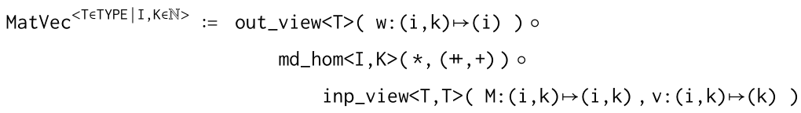

# MDH High-Level Program Representation

[MDH's High-Level Program Representation](https://dl.acm.org/doi/10.1145/3665643) gives data-parallel computations a compact, regular structure based on three higher-order functions composed in a fixed order:

- `inp_view` captures the accesses to the *input data*
- `md_hom`   expresses the *data-parallel computation*
- `out_view` captures the accesses to the *output data*

In the *Matrix-Vector Multiplication (MatVec)* example above:
- `inp_view` defines two inputs: a matrix `M` of size `IxK` and a vector `v` of size `K`; at each point `(i,k)`, the matrix is accessed at position `(i,k)` and the vector at position `(k)`.
- `md_hom` multiplies the matrix and vector elements using `*`, then combines the intermediate results along the `i`-dimension using concatenation (`++` in MDH) and along the `k`-dimension using point-wise addition (`+`).
- `out_view` is trivial in this example, but it can define more advanced output access patterns, such as storing the result of *Matrix Multiplication (MatMul)* in transposed form.
