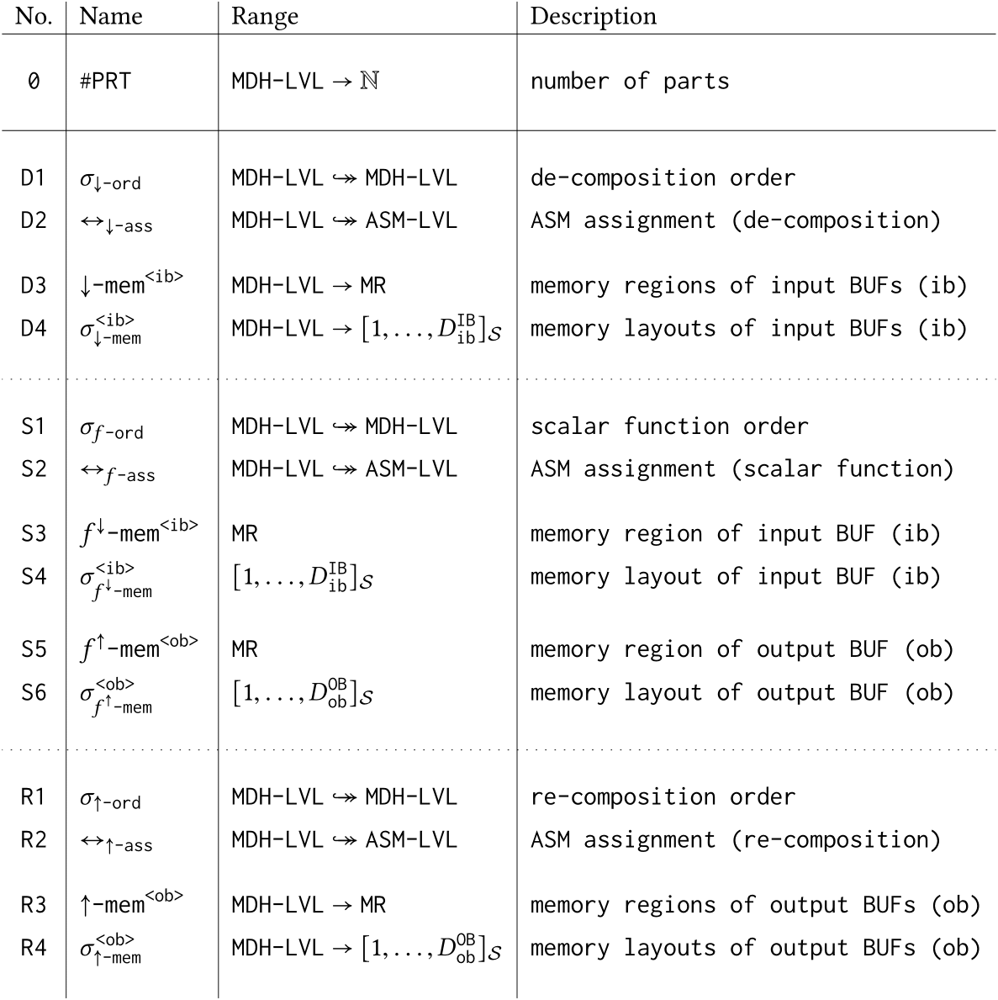

# MDH Lowering: From High-Level to Low-Level

[MDH's Lowering Process](https://dl.acm.org/doi/10.1145/3665643) fully automatically lowers a data-parallel computation expressed in its [high-level program representation](/mdh_hl) to an architecture- and data-optimized instance in its [low-level representation](/mdh_ll).
MDH's lowering process exposes performance-critical parameters, such as tile sizes and thread counts.
Each parameter configuration produces a semantically equivalent low-level instance that reflects different optimization decisions.
Currently, MDH uses the [Auto-Tuning Framework (ATF)](https://www.atf-tuner.org) to fully automatically determine architecture- and data-optimized values of tuning parameters.

Overview of *MDH Tuning Parameters:*

