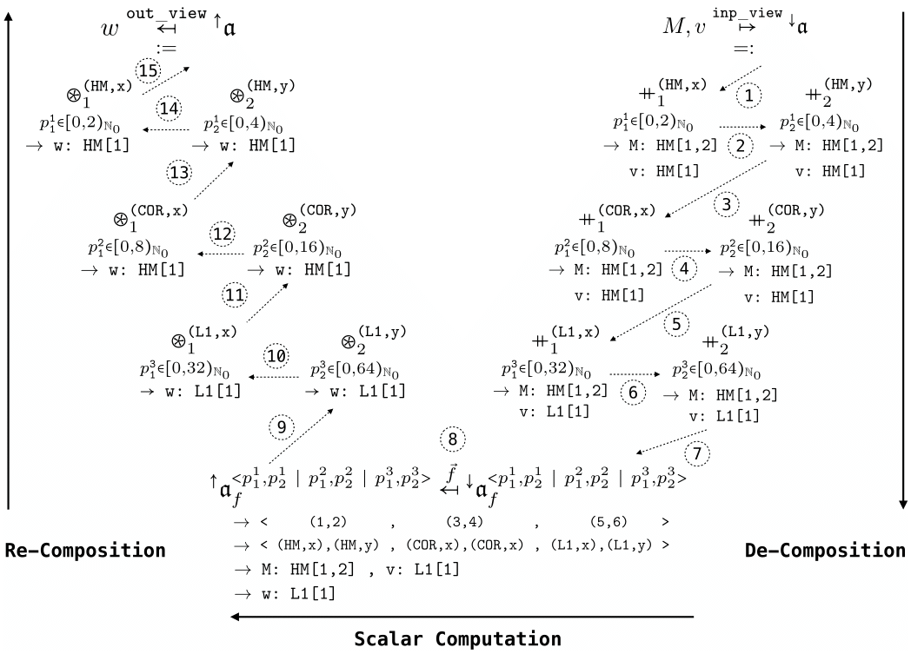
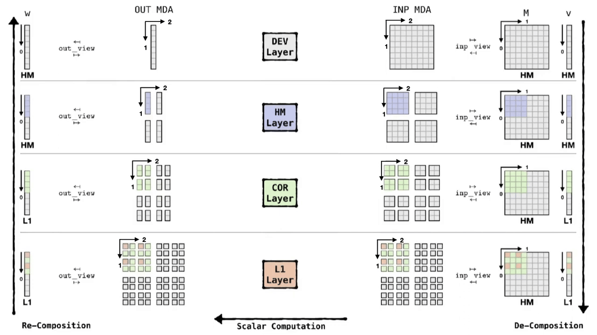

# MDH Low-Level Program Representation

[MDH's Low-Level Program Representation](https://dl.acm.org/doi/10.1145/3665643) formally expresses how a data-parallel computation is de- and re-composed across the memory and core hierarchies of a parallel architecture.

The figure above shows a low-level instance of *Matrix-Vector Multiplication (MatVec)* for a simple example architecture:

- *de-composition phase* (right): partitions the input gradually for the memory and core layers (`HM`/`L1` and `COR`), in each of MatVec's two dimensions (`i` and `k`).
- *scalar phase* (bottom): multiplies the partitioned matrix and vector elements.
- *re-composition phase* (left): combines intermediate results along the `i`-dimension by concatenation and along the `k`-dimension by point-wise addition.

Visualization of a straightforward low-level instance for MatVec:

