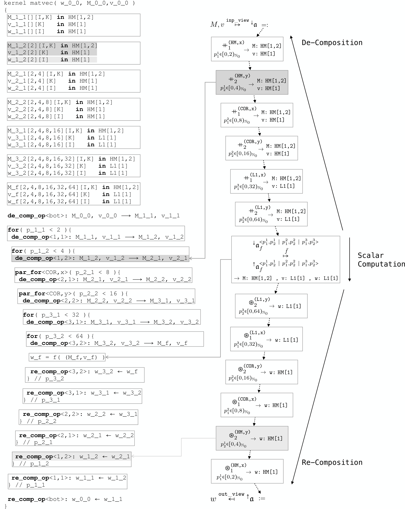

# MDH Lowering: From Low-Level to Code-Level

The MDH compiler systematically transforms a device- and data-optimized instance in the [low-level program representation](/mdh_ll) (`LL-IR`) into an equivalent instance in the [code-level program representation](/mdh_cl) (`CL-IR`).
This `LL➜CL` stage shifts the paradigm from functional MDH building blocks to an imperative, C-like form with loops, control flow, and memory allocation, from which executable target code can then be generated straightforwardly.

